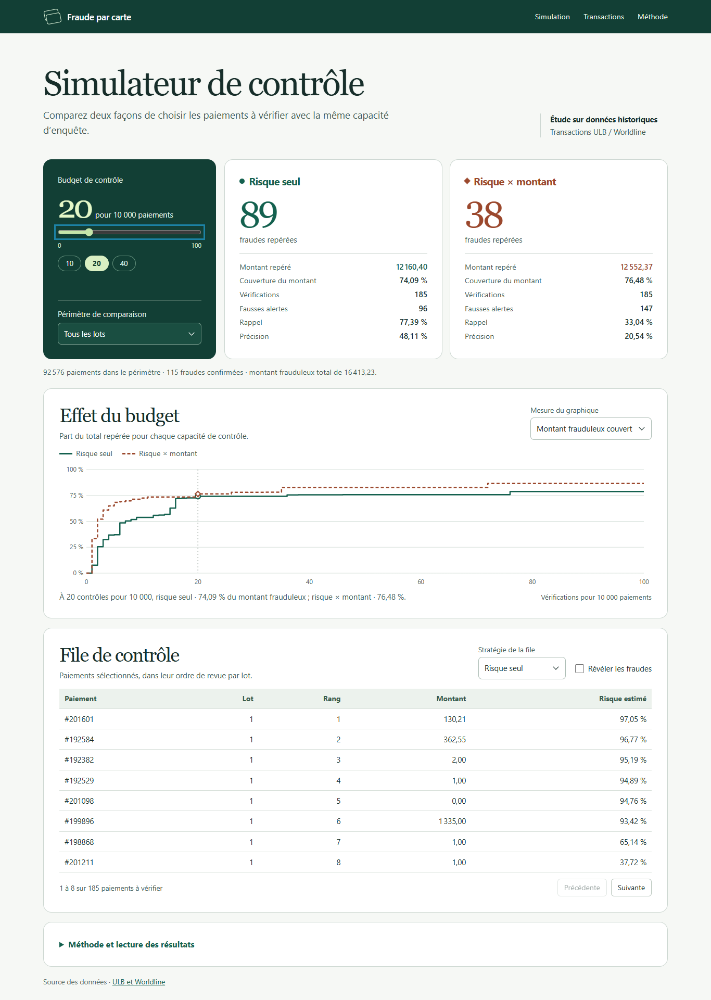
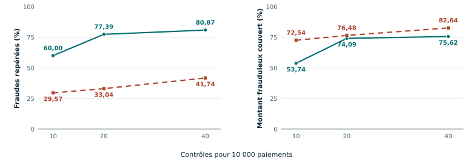

# Détection de fraude par carte bancaire

### Aymen Hammami · Data science appliquée à la finance

**Quelles transactions contrôler quand une équipe ne peut vérifier que vingt paiements sur dix mille ?**

Ce projet compare deux stratégies qui utilisent le même modèle et le même budget. La première privilégie la probabilité de fraude. La seconde multiplie cette probabilité par le montant du paiement.

[**Tester l’application en ligne**](https://aymen-data.github.io/credit-card-fraud-portfolio/) · [**Voir la présentation**](https://aymen-data.github.io/credit-card-fraud-portfolio/presentation.html) · [**Lire le notebook**](notebooks/Detection_fraude_carte_bancaire.ipynb) · [**Consulter le mémoire PDF**](memoire/Memoire_Aymen_Hammami.pdf)



## Explorer le projet

| Ressource | Contenu |
| --- | --- |
| [Application interactive](https://aymen-data.github.io/credit-card-fraud-portfolio/) | Choix du budget de 0 à 100 contrôles pour 10 000 paiements, exploration par lot, inspection des alertes |
| [Notebook Python exécuté](notebooks/Detection_fraude_carte_bancaire.ipynb) | Préparation, modèles, calibration, test chronologique et analyse des deux sélections |
| [Notebook en HTML](https://aymen-data.github.io/credit-card-fraud-portfolio/notebook.html) | Lecture dans un navigateur après téléchargement |
| [Mémoire PDF](memoire/Memoire_Aymen_Hammami.pdf) et [source LaTeX](memoire/main.tex) | 18 pages, protocole, résultats, discussion et références |
| [Présentation HTML](https://aymen-data.github.io/credit-card-fraud-portfolio/presentation.html) | 11 diapositives, trois graphiques, notes de soutenance et simulateur intégré hors ligne |

Télécharger le dépôt avec **Code → Download ZIP**, puis ouvrir `docs/presentation.html` ou `docs/index.html` pour les utiliser hors ligne. La présentation se pilote avec les flèches du clavier et propose un mode plein écran.

## Résultat principal

Le test porte sur **92 576 paiements**, dont **115 fraudes** totalisant **16 413,23 unités monétaires**. Les transactions forment neuf lots complets de 10 000 et un dernier lot de 2 576. La capacité de ce dernier est proportionnelle à sa taille, arrondie à l’entier inférieur.

À vingt contrôles pour dix mille paiements, chaque stratégie sélectionne **185 paiements**.

| Résultat observé | Risque seul · p | Risque × montant · p × A |
| --- | ---: | ---: |
| Contrôles | 185 | 185 |
| Fraudes repérées | **89 / 115** | 38 / 115 |
| Rappel | **77,39 %** | 33,04 % |
| Fausses alertes | 96 | 147 |
| Montant frauduleux repéré | 12 160,40 | **12 552,37** |
| Part du montant frauduleux couverte | 74,09 % | **76,48 %** |

Le classement pondéré couvre **391,97 unités supplémentaires** et repère **51 fraudes de moins**. Son avantage tient à une fraude de 480,72 unités, propre à sa sélection, qui compense les 52 petites fraudes totalisant 88,75 unités propres à la sélection par risque. En excluant le premier lot, l’écart devient **−84,75 unités**.



Les deux panneaux montrent le rappel et la couverture monétaire aux budgets 10, 20 et 40. Les montants repérés mesurent l’exposition identifiée rétrospectivement. Les pertes effectivement évitées demanderaient des données sur les interventions et les recouvrements.

## Méthode

Les données publiques ULB / Worldline regroupent **284 807 paiements**, dont **492 fraudes**, sur deux jours de septembre 2013. Les variables comprennent 28 composantes anonymisées, un montant et un temps relatif au premier paiement.

1. **Séparer dans le temps** — entraînement sur les heures 0–24, calibration sur 24–30, validation sur 30–36 et test sur 36–48.
2. **Comparer les modèles** — régression logistique, réseau de neurones et boosting d’arbres apprennent sur les mêmes 281 fraudes et 8 430 paiements légitimes de l’entraînement.
3. **Recalibrer les probabilités** — une calibration sigmoïde utilise sa propre fenêtre chronologique.
4. **Choisir avant le test** — le boosting obtient la meilleure précision moyenne (AP) de validation, 0,6825. La régression logistique possède le meilleur Brier calibré.
5. **Évaluer la décision** — les deux classements partagent le boosting figé, les mêmes lots et la même capacité. Les étiquettes de fraude servent à mesurer les résultats après sélection.

Le notebook vérifie la séparation des périodes et calcule les résultats par lot, les métriques globales et la sensibilité au budget. Le modèle retenu atteint une AP de 0,7804 sur le test.

## Rejouer l’analyse

L’environnement des calculs enregistrés utilise Python 3.13.9. Depuis la racine du dépôt, créer un environnement et installer les dépendances.

```bash
python -m venv .venv
# Windows PowerShell
.venv\Scripts\Activate.ps1
# macOS / Linux
# source .venv/bin/activate
python -m pip install -r requirements.txt
python -m jupyterlab
```

Ouvrir `notebooks/Detection_fraude_carte_bancaire.ipynb` et exécuter toutes les cellules. Le notebook télécharge le CSV depuis le miroir du tutoriel officiel TensorFlow et vérifie son empreinte SHA-256. Un téléchargement initial requiert une connexion. On peut aussi renseigner `CHEMIN_CSV` avec un fichier local. Les sorties présentes dans le notebook restent lisibles sans relancer les modèles.

L’application et le diaporama sont autonomes. Ils utilisent les probabilités et les classements archivés de l’expérience. Modifier le budget recalcule les sélections, et le modèle conserve ses paramètres.

Pour compiler le mémoire avec une distribution TeX comprenant XeLaTeX et les packages utilisés dans le fichier, lancer deux fois depuis le répertoire `memoire/`.

```bash
xelatex -interaction=nonstopmode main.tex
xelatex -interaction=nonstopmode main.tex
```

## Portée et perspectives

Deux jours anciens limitent la généralisation à une activité bancaire actuelle. La validation ne contient que 27 fraudes et le résultat monétaire du test dépend fortement d’une transaction. Le fichier ne fournit ni identifiant de carte, ni délai de confirmation des étiquettes, ni coût réel des enquêtes.

Une suite de recherche pourrait répéter le test sur des fenêtres glissantes, prendre en compte les délais d’étiquetage et rapprocher chaque contrôle des sommes récupérées et du temps passé.

## Origine et sources

Cette version révisée est signée **Aymen Hammami**. Elle prolonge le mémoire de mastère réalisé en binôme à ESG Finance en 2019–2020, spécialité Big Data et Data Science en Finance. Les résultats affichés ici proviennent de l’expérience reconstruite et exécutée pour la révision de novembre 2026.

- [Jeu de données ULB / Worldline](https://www.kaggle.com/datasets/mlg-ulb/creditcardfraud)
- [Miroir et tutoriel TensorFlow sur les classes déséquilibrées](https://www.tensorflow.org/tutorials/structured_data/imbalanced_data)
- [Fraud Detection Handbook — validation chronologique](https://fraud-detection-handbook.github.io/fraud-detection-handbook/Chapter_5_ModelValidationAndSelection/ValidationStrategies.html)

La bibliographie complète figure dans le mémoire. Les conditions d’utilisation du jeu de données relèvent de sa source.
